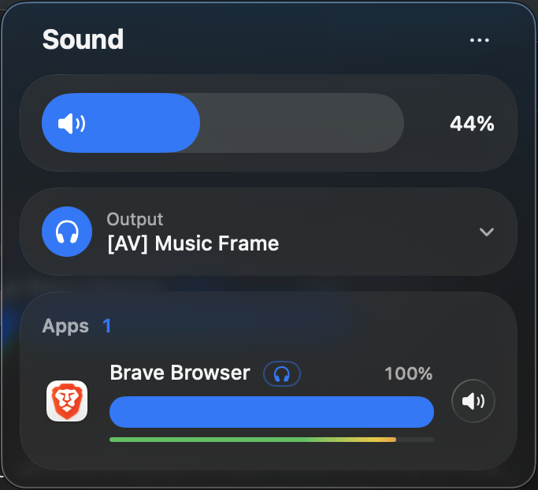

# Menubar Mixer

A native SwiftUI menu-bar volume mixer for macOS 14.4+, styled after Control Center with Liquid Glass on macOS 26.

- **Master volume**: a Control Center–style bar with mute, plus an output picker.
- **Per-app volume**: every app that is playing audio gets its own slider, mute button and live level meter.
- **Per-app speakers**: send each app to a different output, for example music to your earbuds and a browser to the laptop speakers at the same time.
- **Remembers your settings**: each app's volume, mute and speaker are restored the next time it plays.
- **Muted-speaker warning**: an app routed to a device that macOS has muted shows a red warning.
- Light and dark appearance, optional launch at login, no Dock icon.

<p align="center"></p>

## Install (download)

1. Download `Menubar-Mixer-1.0.zip` from the [latest release](../../releases/latest) and unzip it. It runs on Apple silicon and Intel.
2. Move **Menubar Mixer.app** to Applications and open it.
3. The app isn't notarized, so macOS blocks the first launch. Open **System Settings → Privacy & Security**, scroll down and click **Open Anyway**. Alternatively, run this once:
   ```sh
   xattr -dr com.apple.quarantine "/Applications/Menubar Mixer.app"
   ```
4. Allow **System Audio Recording** when asked. Without it, the master volume and output picker still work, but per-app sliders are disabled.

The icon (three sliders) appears in the menu bar. If you don't see it, your menu bar may be full: on a notched MacBook, extra icons hide behind the notch. Remove or ⌘-drag away a few other icons.

## Build from source

Needs macOS 14.4+ and the Xcode Command Line Tools (`xcode-select --install`). Full Xcode isn't required.

```sh
chmod +x make-app.sh       # once, after cloning
./make-app.sh              # builds "Menubar Mixer.app" here (SwiftPM + ad-hoc codesign)
open "Menubar Mixer.app"   # always launch via open/Finder, not the raw binary
./make-app.sh --install    # also copy to ~/Applications and launch from there
./make-app.sh --release    # universal build zipped into dist/ for sharing
```

The bundle is ad-hoc signed with an identifier-only designated requirement, so the audio permission survives rebuilds. If macOS ever asks again after a rebuild, allow it and restart the app once.

## How per-app volume works

For each playing app, `CATapDescription` + `AudioHardwareCreateProcessTap` taps all of that app's audio processes, muting the original (`mutedWhenTapped`). Browser helper processes roll up into the browser. A private aggregate device (tap in → output device) plays the audio back with a gain applied in the IOProc.

Every app gets its own aggregate device, so each app can also be routed to a different speaker. Apps you haven't adjusted get a listen-only tap that only feeds the level meter and leaves their audio untouched. Turn off *Live level meters* in the ⋯ menu to skip that. Adjusting or re-routing an app takes over all of its audio.

Settings are stored in UserDefaults. ⋯ → *Launch at login* uses `SMAppService`, and macOS may ask you to approve it under Login Items.

## Limits

- **Browser tabs:** Chromium browsers (Brave, Chrome) play every tab through one audio process, so CoreAudio can't tell tabs apart. Per-tab volume or speaker choice would need a browser extension.
- **Latency:** adjusted and routed apps are delayed by roughly one audio buffer (a few ms). That's fine for music, but may show as slight lip-sync drift on Bluetooth video.
- **Device volume still applies:** a routed app's loudness also depends on that device's own volume and mute. The master slider controls the system output.

## Diagnostics

- **Log:** `~/Library/Logs/MenubarMixer.log` (⋯ → Open log file).
- **`MenubarMixer diag [--volume-roundtrip]`:** lists devices, audio processes and permission state.
- **`open -n "Menubar Mixer.app" --args selftest`:** plays a test tone, taps it at several gains and logs what comes out. Output peaks should scale exactly with gain.
- **`open -n "Menubar Mixer.app" --args selftest2`:** does the same with two tones sent to two different speakers. Run both self-tests through `open` so macOS applies the app's audio permission.
- **`MenubarMixer snapshot out.png [--dark] [--denied] [--unknown] [--empty] [--many] [--devices] [--muted]`:** renders the panel with canned data. Offscreen renders can't draw Liquid Glass, so cards show a flat fill.
